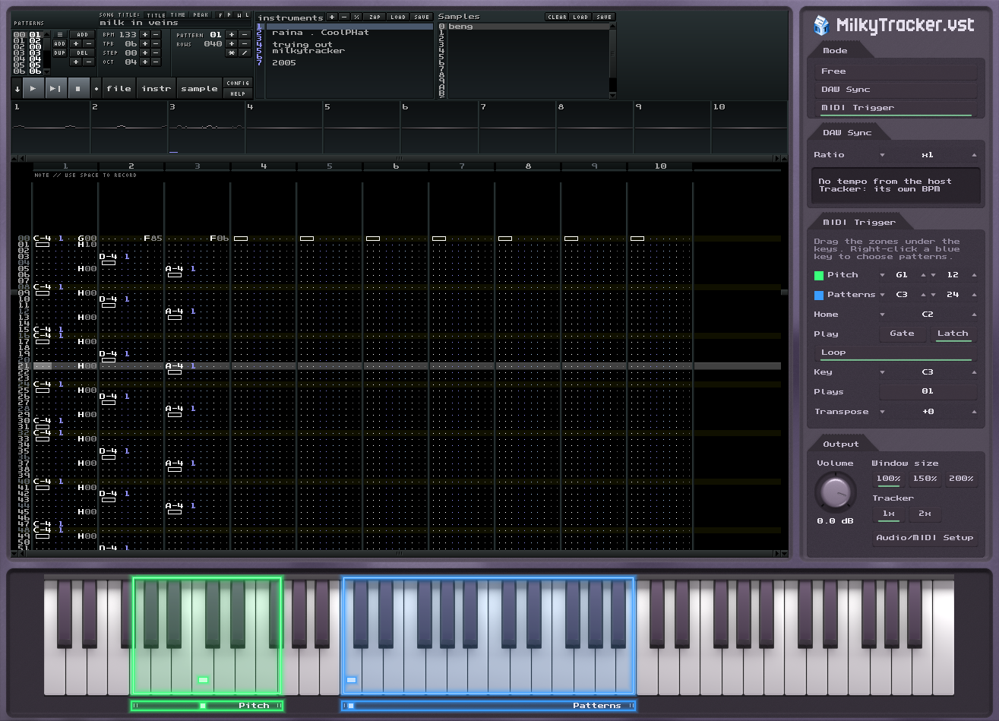

# MilkyTracker.vst



**MilkyTracker.vst** is [MilkyTracker](https://milkytracker.org), the Fasttracker II compatible tracker, running inside a DAW as an instrument plug-in: the whole tracker as it is, with a column of plug-in controls beside it and a keyboard below. It follows the host's tempo and transport (DAW Sync), plays a song's patterns from MIDI keys (MIDI Trigger), or plays as the tracker on its own (Free), and the song goes into the DAW's project with everything else. CLAP, VST3, VST2 and standalone on Windows, macOS and Linux, an AU on macOS and a 32-bit VST2 with a DXi on Windows, the same set FSVR builds, from the same framework.

**[Download the latest release](https://github.com/musicastudio/MilkyTracker.vst/releases/latest)**

Discord: https://discord.gg/VTMqnpvpj8

Licensed GPL-3, as MilkyTracker is, see `COPYING` (MilkyPlay, its player library, is New-BSD).

## What it does

**The tracker.** MilkyTracker's own screen at 1024 x 720 on the left of the window: the pattern editor, instruments, samples, the config pages, its keys and its mouse, unchanged. Click into it and it has the keyboard, typing notes by key place as Fasttracker II does, ahead of the host's shortcuts, on Windows, macOS and Linux alike. Its Config page's Scale, or the Tracker 1x and 2x buttons in the column, show it at twice the size in the same area, a quarter at a time, with neon bars on the well's dividers to pan it.

**Three modes**, picked at the top of the column.

- **Free.** The tracker plays as itself, at its own BPM, from its own buttons and keys. MIDI from the host and the on-screen keyboard play and record through the current instrument.
- **DAW Sync.** The tracker's BPM is the host's times the Ratio (x1 is four rows a beat at speed 6, as Fasttracker II counts it; x2 eight, x1/2 two). The song starts, stops and jumps with the host's transport, at the order and row the host's position falls on, and its own `Bxx` and `Dxx` jumps play as written between the host's.
- **MIDI Trigger.** Two zones of the keyboard light up in neon. A **blue** key plays the patterns listed for it, one after another, held (Gate) or toggled (Latch), looping or not; right-click it, or press the column's Plays button, to pick its patterns. A **green** key moves the pitch of whatever plays by its distance from Home. Drag the zones, their ends and their markers on the strip under the keys.

**The session.** The song goes into the host's project as an XM file and comes back out of it when the project opens, with each key's patterns and the column's settings. MilkyTracker's own settings stay its own, in a settings file of the plug-in's.

**The editor** is powered by the [Hollow](hollow/docs/framework.md) framework.

[plugin/README.md](plugin/README.md) has the detail: how each mode keeps time, the threads, the session, the checks, and what changed in MilkyTracker for it.

## Background

MilkyTracker was created by Peter Barth ([pailes](https://github.com/milkypailes)), carried on since by the MilkyTracker team (see `AUTHORS`) at [milkytracker/MilkyTracker](https://github.com/milkytracker/MilkyTracker).

This plug-in/VST version is a fork from the official repo, created by James Hansen ([jameshansen](https://github.com/jameshansen)).

The plug-in drives MilkyTracker's own Tracker class, unchanged in what it does: it draws into a screen in memory instead of a window, plays through the host's audio instead of a driver of its own, and takes the host's tempo, transport and MIDI through a few calls added to its player (`PlayerController`'s `host*` calls, `PlayerSTD::setTickRate`, `setTranspose` and `setPatternQueue`). Everything around it, the column, the keyboard, the zones, the patterns dialog and the formats, is Hollow's, with the plug-in's own processor in `plugin/plugin.cpp`.

## Build and run

### Building it

CMake 3.22 or later, a C++17 compiler (Visual Studio 2022 on Windows, the Xcode command line tools on macOS), and the network on the first configure, which downloads the CLAP SDK and [clap-wrapper](https://github.com/free-audio/clap-wrapper), which fetches the VST3 and AU SDKs, RtAudio and RtMidi.

```bash
cmake -S . -B build/plugin -G "Visual Studio 17 2022" -A x64 -DMILKYTRACKER_PLUGIN=ON
```

```bash
cmake --build build/plugin --config Release
```

The same with `-A Win32` into `build/plugin-x86` makes the 32-bit VST2 with the DXi in it. On macOS and Linux it is `cmake -S . -B build -G Ninja -DCMAKE_BUILD_TYPE=Release -DMILKYTRACKER_PLUGIN=ON`, then `cmake --build build`. On Linux install `libx11-dev libasound2-dev libjack-jackd2-dev libpulse-dev pkg-config` first (Debian and Ubuntu names); the plug-in needs no SDL, and its file dialogs are zenity's or kdialog's. The macOS standalone app needs Xcode, since clap-wrapper compiles its menu with `ibtool`; with the command line tools alone everything else builds and the app is left out.

Every format lands in a folder of its own under `bin/` as `MilkyTrackerVST`: `bin/CLAP/MilkyTrackerVST.clap`, `bin/VST3/MilkyTrackerVST.vst3`, `bin/VST2`, `bin/Standalone/MilkyTrackerVST.exe`, `bin/AU/MilkyTrackerVST.component` on macOS, and `bin/VST2 32-bit and DXi` from the 32-bit build. Hosts list it, and its window's title bar reads, MilkyTracker.vst.

### Checking a change

```bash
python plugin/test.py
```

That builds every format and runs every check on all three platforms: Windows where it runs, Linux and macOS over ssh on the machines `../VirtualMac/README.txt` sets up, and brings the screenshots and logs back to `build/test-report/`. Name platforms to run only those (`python plugin/test.py windows`). After a build on one machine, `ctest --test-dir build/plugin -C Release` runs the same checks there.

- `plugin` drives the processor as a host does: a session's module restored, DAW Sync on the transport, MIDI Trigger's keys and transpose, the dialog's commands, the strip's drags, the module saved back
- `gui` drives the editor without a window, as a mouse and a keyboard do: every control, the neon zones by their pixels, the patterns dialog, a note typed into the tracker and read back out of the saved module, every scale, the tracker at 2x and MilkyTracker's own Config page
- `host_clap`, `host_vst3`, `host_vst2` and `host_au` load each built binary as a host loads it, with an audio thread in real time and the editor in a real window (Win32, X11 or Cocoa): its state, transport, MIDI, a second instance, three sample rates, and clicks, keys and a resize sent as the platform's own events
- `host_standalone` starts the app, reads its title bar, captures its window and closes it
- `vst3_validator` is Steinberg's VST3 validator, and macOS adds Apple's `auval`

## Repo Layout

**The plug-in.**

- `plugin/plugin.cpp` the processor: the three modes, the mix pulled from the tracker one beat packet at a time, the worker that takes MIDI to the tracker and keeps the pattern lists and the session
- `plugin/tracker_host.cpp` MilkyTracker's Tracker on a screen in memory, and the view the skin shows it through, with its mouse and its keys translated as MilkyTracker's Windows port makes them
- `plugin/skin/` the Hollow skin: `views/main.json` (the tracker, the column, both keyboards and the zone strip), `views/column.json`, `views/dialog_patterns.json`, `params.json`, and the art and fonts at every scale
- `plugin/check_plugin.cpp`, `check_gui.cpp`, `check_host.cpp` and `test.py` the checks above
- `blender/` the art: FSVR's Blender kit recoloured violet and darkened, with this window's layout in `scripts/layout.py`, MilkyTracker's fonts made into glyph strips by `scripts/mt_fonts.py` and the carton by `scripts/carton.py`
- `hollow/` the plug-in framework, FSVR's, with what this plug-in added: a view the product draws (`pixels`), raw keys on every platform, the keyboard's neon zones and their strip, zoom and pan, greyed-out controls. [hollow/docs/skin-format.md](hollow/docs/skin-format.md) is the skin's contract

**MilkyTracker.**

- `src/tracker` the tracker, `src/milkyplay` its player, `src/ppui` its UI toolkit, `src/compression` its unpackers, all upstream's with the few changes [plugin/README.md](plugin/README.md) lists
- `resources/` its fonts, pictures and example songs, `docs/` its own documentation

## MilkyTracker itself

Without `MILKYTRACKER_PLUGIN` this repository builds MilkyTracker the app, as upstream does. [INSTALL.md](INSTALL.md) has its build instructions, [docs/readme_unix](docs/readme_unix) the notes for its SDL port, and [milkytracker.org](https://milkytracker.org) its downloads, manual and [community](https://milkytracker.org/community/).
